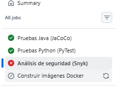
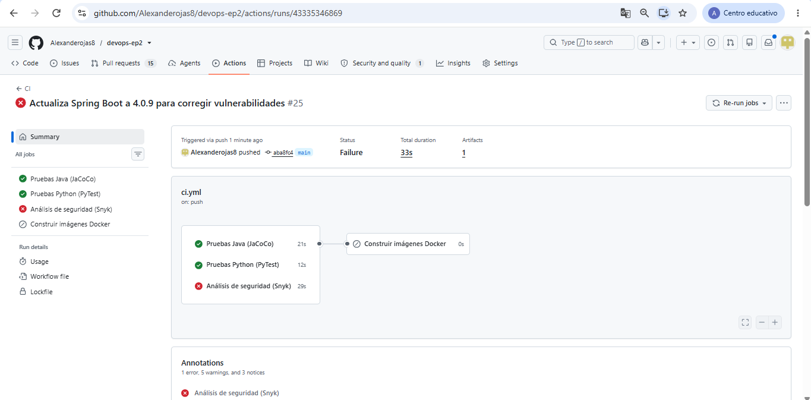
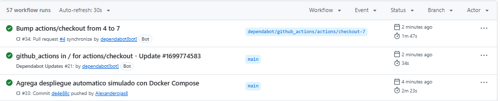
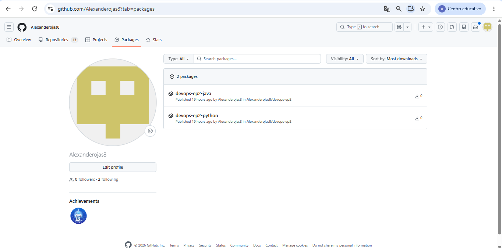
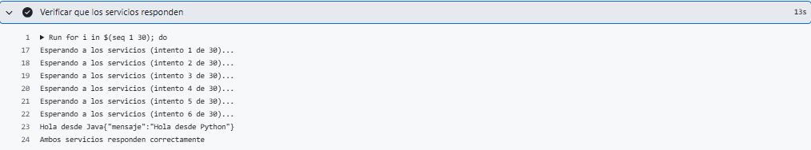
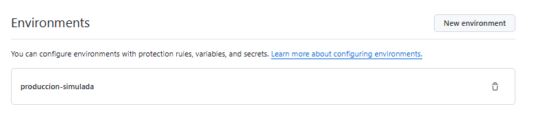

# devops-ep2: pipeline CI/CD con GitHub Actions

Evaluación Parcial 2, Ingeniería DevOps (DOY0101).

**Integrantes:** Alexander Rojas y Niover Guevara

## Descripción

Dos microservicios con tecnologías distintas, contenerizados y automatizados con un pipeline CI/CD en GitHub Actions: pruebas, análisis de seguridad, construcción de imágenes, publicación y despliegue en un entorno simulado con Docker Compose.

| Servicio | Tecnología | Puerto | Endpoints |
|---|---|---|---|
| `servicio-java` | Java 17, Spring Boot 4.0.9, Maven | 8080 | `/saludo`, `/sumar?a=&b=` |
| `servicio-python` | Python 3.12, FastAPI 0.162.2 | 8000 | `/saludo`, `/restar?a=&b=` |

## Estructura del repositorio

```
devops-ep2/
├── .github/
│   ├── dependabot.yml
│   └── workflows/ci.yml
├── docs/evidencias/            (capturas del pipeline)
├── servicio-java/              (código, pruebas, Dockerfile)
├── servicio-python/            (código, pruebas, Dockerfile)
├── docker-compose.yml          (desarrollo: construye las imágenes)
├── docker-compose.deploy.yml   (despliegue: usa imágenes del registro)
└── README.md
```

## Cómo ejecutarlo en local

Requiere Docker Desktop abierto.

```bash
docker compose up --build
```

Luego abrir `http://localhost:8080/saludo` y `http://localhost:8000/saludo`. Para apagar: `docker compose down`.

## Contenedores (IE1)

- **Java:** Dockerfile de dos etapas. La primera compila con Maven y la segunda ejecuta solo el JAR sobre una imagen JRE liviana (`eclipse-temurin:17-jre-alpine`).
- **Python:** imagen base `python:3.12-slim`, con instalación sin caché de pip.
- Cada servicio tiene su `.dockerignore` para no copiar archivos innecesarios.

## Pipeline (`.github/workflows/ci.yml`)

Se ejecuta en cada `push` y `pull request` a `main`.

| Job | Qué hace |
|---|---|
| Pruebas Java (JaCoCo) | Ejecuta las pruebas unitarias y genera el reporte de cobertura, que queda como artefacto descargable |
| Pruebas Python (PyTest) | Ejecuta las pruebas unitarias |
| Análisis de seguridad (Snyk) | Escanea las dependencias de ambos servicios y falla ante vulnerabilidades de severidad alta o crítica |
| Construir imágenes Docker | Construye las dos imágenes y las publica en GitHub Container Registry. Solo corre si los tres jobs anteriores pasan |
| Despliegue simulado | Levanta ambos servicios con Docker Compose usando las imágenes recién publicadas y verifica que respondan. Solo corre en `push` a `main` |

## Seguridad y bloqueo (IE3)

- **Snyk** analiza `pom.xml` y `requirements.txt` con `--severity-threshold=high`. Si encuentra una vulnerabilidad alta o crítica, el job falla y **no se publican imágenes ni se despliega**.
- **Dependabot** revisa semanalmente Maven, pip, los dos Dockerfile y las acciones de GitHub, y abre solicitudes de actualización. También están activas las alertas y las actualizaciones de seguridad.
- **Push protection** de GitHub bloquea subidas con secretos. El token de Snyk se guarda como secreto del repositorio (`SNYK_TOKEN`).
- **Parámetros de despliegue** en `docker-compose.deploy.yml`: límite de memoria y CPU por contenedor (`mem_limit`, `cpus`), `no-new-privileges` y política de reinicio `unless-stopped`.

### Caso real documentado

En la primera ejecución con Snyk, el servicio Java tenía 50 vulnerabilidades altas y críticas (Spring Boot 4.0.0) y el pipeline quedó bloqueado. Se subió Spring Boot a 4.0.9, lo que dejó una sola vulnerabilidad en `jackson-databind`, que se corrigió fijando la versión 3.1.8 en el `pom.xml`. En Python, 5 vulnerabilidades de `starlette` se resolvieron subiendo `fastapi` a 0.162.2. Después de esos cambios el pipeline pasó completo.

## Orquestación (IE5)

Docker Compose define ambos servicios, sus puertos, sus límites de recursos y su política de reinicio. `docker-compose.yml` se usa en desarrollo y construye desde el código. `docker-compose.deploy.yml` se usa en el pipeline y descarga las imágenes ya publicadas.

## Trazabilidad (IE4)

- Cada imagen se publica con dos etiquetas: el **hash del commit** (`github.sha`) y `latest`. Así, cualquier imagen en ejecución se puede rastrear hasta el commit y la ejecución del pipeline que la generó.
- El despliegue usa la etiqueta del commit y no `latest`, de modo que lo desplegado es exactamente lo que pasó las pruebas y el análisis.
- Los despliegues quedan registrados en el entorno `produccion-simulada` de GitHub.
- Cada ejecución del pipeline queda en la pestaña Actions, asociada al commit y a su autor.

## Calidad (IE2)

- Pruebas unitarias en ambos servicios, ejecutadas automáticamente en cada cambio. Un cambio que rompa una prueba no se construye ni se despliega.
- El reporte de cobertura de JaCoCo se guarda como artefacto en cada ejecución.
- Limitación actual: JaCoCo informa la cobertura, pero el pipeline no exige un porcentaje mínimo.

## Evidencias

### 1. Pipeline bloqueado por Snyk (50 vulnerabilidades en Java)


### 2. Tras actualizar Spring Boot (queda 1 vulnerabilidad)


### 3. Pipeline completo en verde


### 4. Imágenes publicadas en GitHub Container Registry


### 5. Despliegue verificado


### 6. Entorno de despliegue registrado


## Uso de inteligencia artificial

Se utilizó Claude (Anthropic) como apoyo en este trabajo, de la siguiente forma:

- Guía paso a paso para instalar y configurar el entorno (Git, Docker, Java, Python, VS Code).
- Borradores de los Dockerfile, de los docker-compose, del workflow de GitHub Actions y de la configuración de Dependabot y Snyk.
- Ayuda para interpretar errores del pipeline y proponer correcciones de versiones de dependencias.
- Borrador inicial de este README, que el equipo revisó y modificó.

Todo el contenido generado fue revisado, ejecutado y validado por el equipo. Las conclusiones individuales fueron redactadas por cada integrante sin apoyo de IA.

Referencia: (completar según el formato indicado en https://bibliotecas.duoc.cl/ia)

## Conclusiones individuales

### Alexander Rojas

(Durante este proyecto aprendí cómo automatizar procesos con GitHub Actions, trabajar con Docker y configurar pruebas y seguridad para los microservicios. También pude mejorar mi capacidad para solucionar errores y entender la importancia de un pipeline antes de desplegar una aplicación.)

### Niover Guevara

(En este proyecto aprendí más sobre Docker, GitHub Actions y la automatización del despliegue. También comprendí la importancia de realizar pruebas y revisar la seguridad de las aplicaciones antes de publicarlas. Fue una buena experiencia para poner en práctica lo aprendido en clases..)